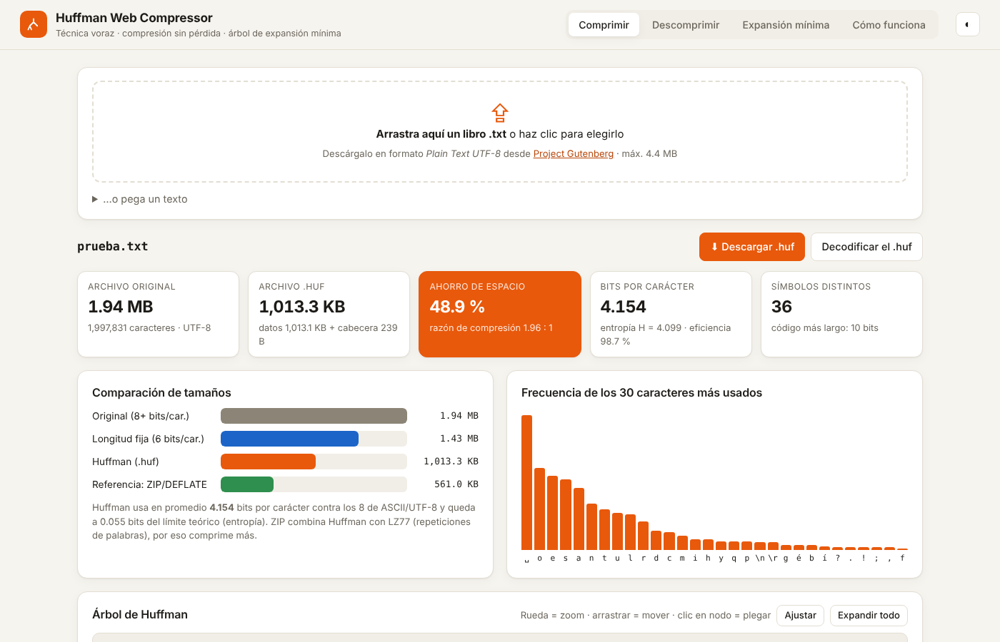

# Huffman Web Compressor

Compresor de texto sin pérdida que usa el **algoritmo voraz de Huffman**, con interfaz gráfica web hecha en **Python (Flask)**. Incluye además el **árbol de expansión mínima** con **Kruskal** y **Prim**, animados paso a paso.

Actividad de Análisis de Algoritmos sobre la técnica voraz.



## Qué hace

1. **Lee un archivo `.txt`** (por ejemplo, un libro de [Project Gutenberg](https://www.gutenberg.org/) en *Plain Text UTF-8*) y **calcula la frecuencia** de cada carácter.
2. **Construye el árbol de Huffman con la técnica voraz.** Una cola de prioridad (min-heap) extrae en cada paso los dos nodos de menor frecuencia y los fusiona, hasta que queda una sola raíz. La interfaz muestra cada fusión.
3. **Genera el código binario** de cada carácter: rama izquierda = `0`, rama derecha = `1`.
4. **Codifica** el texto en bits y lo empaqueta en un archivo binario real **`.huf`**. Después lo **decodifica** y comprueba que el resultado es idéntico byte a byte al original.
5. **Compara tamaños**: original, `.huf` (datos + cabecera), codificación de longitud fija y ZIP como referencia. También reporta la entropía de Shannon y la eficiencia del código.
6. **Árbol de expansión mínima**: genera un grafo aleatorio o acepta aristas escritas a mano, y anima Kruskal (con Union-Find) y Prim (con cola de prioridad).

## Estructura

```
huffman/
  core.py      Huffman: frecuencias, árbol voraz, códigos, codificar/decodificar, formato .huf
  mst.py       Árbol de expansión mínima: Kruskal, Prim, Union-Find, generador de grafos
app.py         Servidor Flask (API + GUI) y punto de entrada en Vercel
public/        Interfaz gráfica: HTML, CSS, JS y D3 para dibujar el árbol
tests/         Pruebas automáticas
capturas/      Capturas del funcionamiento
vercel.json    Configuración del despliegue
```

## Ejecutar en local

```bash
python -m venv .venv
source .venv/bin/activate          # Windows: .venv\Scripts\activate
pip install -r requirements.txt
python app.py                      # abre http://127.0.0.1:5000
```

Pruebas:

```bash
python tests/test_huffman.py
```

## Desplegar en Vercel

1. En [vercel.com/new](https://vercel.com/new), importa este repositorio.
2. Vercel detecta el preset **Flask** (`app.py` + `requirements.txt`). No hace falta configurar nada más.
3. Cada `git push` a `main` vuelve a desplegar la app.

> Vercel limita el cuerpo de cada petición a unos 4.5 MB, así que la app acepta archivos de hasta 4.4 MB. Casi todos los libros de Gutenberg caben (Don Quijote pesa unos 2.2 MB).

## Formato del archivo `.huf`

| Campo | Tamaño |
|---|---|
| Firma `HUF1` | 4 B |
| Codificación del texto (0 = UTF-8, 1 = Latin-1) | 1 B |
| Número de símbolos `n` | 4 B |
| Por símbolo: longitud del carácter en UTF-8, el carácter y su frecuencia | 1 B + 1–4 B + 4 B |
| Número de bits válidos | 8 B |
| Bits codificados, empaquetados en bytes | ⌈bits / 8⌉ B |

El decodificador **reconstruye el mismo árbol** a partir de la tabla de frecuencias (los empates se rompen siempre igual). Por eso la cabecera cuenta dentro del tamaño comprimido.

## Complejidad

| Etapa | Costo |
|---|---|
| Contar frecuencias | O(N), con N = caracteres del texto |
| Construir el árbol (heap) | O(n log n), con n = símbolos distintos |
| Generar códigos | O(n) |
| Codificar / decodificar | O(N) |
| Kruskal | O(E log E) |
| Prim | O(E log V) |

Para decodificar rápido se usa una tabla de búsqueda de 12 bits que resuelve casi todos los códigos en un solo paso; los códigos más largos terminan de recorrerse en el árbol.
